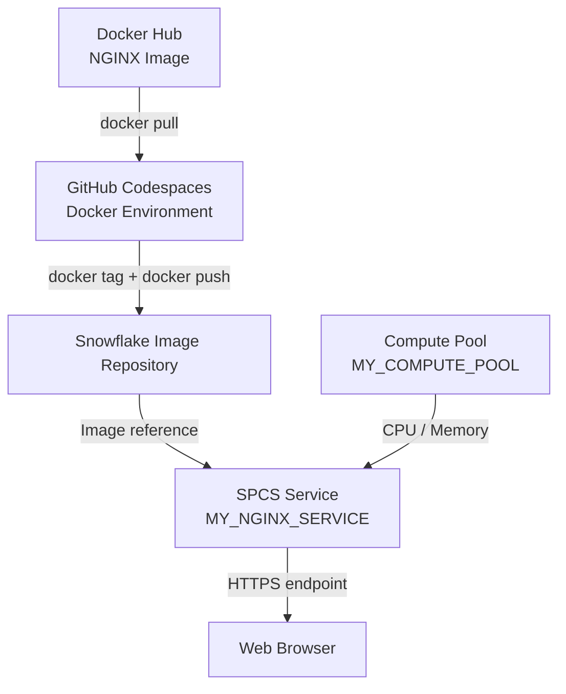
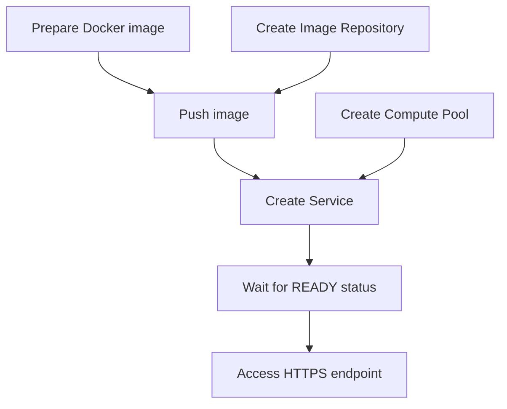

# Deploying NGINX with Snowflake Python API and Snowpark Container Services

A hands-on project demonstrating how to provision and manage Snowpark Container Services (SPCS) resources using the Snowflake Python API, push a Docker image to the Snowflake Image Registry, and deploy an NGINX web server with an HTTPS endpoint.

## Overview

Snowflake is not limited to storing and processing data. With Snowpark Container Services, it can also run containerized applications using managed compute resources.

This project demonstrates the deployment lifecycle of a containerized application on Snowflake, from preparing the image to accessing the running service.

**Project objectives:**

- Connect to Snowflake using the Snowflake Python API.
- Create and manage Snowflake infrastructure resources programmatically.
- Store a Docker image in a Snowflake Image Repository.
- Provision a Compute Pool for container execution.
- Deploy NGINX as a Snowpark Container Services Service.
- Expose the application through an HTTPS endpoint.
- Verify the deployment and suspend resources to control costs.

NGINX is used as a lightweight example application. The same general deployment pattern can be adapted for custom applications, such as Python REST APIs and machine learning inference services.

## Architecture



### Component responsibilities

| Component | Responsibility |
|---|---|
| GitHub Codespaces | Development environment used to run Python and Docker commands. |
| Docker Image | Packaged application and its runtime dependencies. |
| Snowflake Image Repository | Stores Docker images that can be used by Snowpark Container Services. |
| Compute Pool | Provides the CPU and memory resources required to run containers. |
| Service | Defines and manages the application running on a Compute Pool. |
| HTTPS Endpoint | Provides access to the deployed application. |

**Important distinction:** An image repository stores application images, while a Compute Pool provides execution resources. Creating a Service connects these components and starts the application.

## Technology Stack

- **Snowflake:** Data platform and infrastructure provider.
- **Snowflake Python API:** Programmatic management of Snowflake resources.
- **Snowpark Container Services:** Container execution and service management.
- **Docker:** Container image management.
- **NGINX:** Example web server.
- **Python:** Infrastructure provisioning scripts.
- **GitHub Codespaces:** Cloud development environment.

## Project Structure

```text
snowflake-python-api-container-services/
├── README.md
├── .gitignore
└── scripts/
    ├── 01_check_database.py
    ├── 02_create_database.py
    ├── 04_create_image_repository.py
    ├── 05_create_compute_pool.py
    └── 06_create_service.py
```

The scripts are intentionally separated by resource type to demonstrate how individual Snowflake objects are created and managed through the Python API.

## Prerequisites

Before starting, the following are required:

- A Snowflake account with access to Snowpark Container Services.
- Sufficient privileges to create databases, image repositories, Compute Pools, and Services.
- Python and the Snowflake Python API.
- A working Docker installation.
- A configured Snowflake connection.

Install the Python dependencies:

```bash
pip install snowflake
```

The project uses a named Snowflake connection:

```python
snowflake.connector.connect(connection_name="tutorial")
```

Connection credentials are configured outside the repository. **Do not commit passwords, private keys, or connection configuration files containing secrets.**

## Implementation

### 1. Establish the Snowflake connection

The project uses the Snowflake Connector for Python to authenticate and the `Root` object to access Snowflake resources through the Python API.

```python
import snowflake.connector
from snowflake.core import Root

with snowflake.connector.connect(connection_name="tutorial") as conn:
    root = Root(conn)
```

The `Root` object provides access to resource collections such as databases and Compute Pools.

### 2. Create the database

The database used in this project is:

```text
SPCS_PYTHON_API_DB
```

The Python API creates the database if it does not already exist.

Implementation:

```bash
python scripts/02_create_database.py
```

Verification in a Snowflake SQL Worksheet:

```sql
SHOW DATABASES LIKE 'SPCS_PYTHON_API_DB';
SHOW SCHEMAS IN DATABASE SPCS_PYTHON_API_DB;
```

The project uses the database's `PUBLIC` schema.

### 3. Create an Image Repository

A Snowflake Image Repository stores the container images used by Snowpark Container Services.

Repository name:

```text
SPCS_PYTHON_API_DB.PUBLIC.MY_IMAGE_REPOSITORY
```

Implementation:

```bash
python scripts/04_create_image_repository.py
```

Verification:

```sql
SHOW IMAGE REPOSITORIES
IN SCHEMA SPCS_PYTHON_API_DB.PUBLIC;
```

The resulting `repository_url` identifies the destination for Docker image uploads.

### 4. Create a Compute Pool

A Compute Pool provides the compute resources on which containers execute.

This project uses the following configuration:

| Property | Value |
|---|---|
| Name | `MY_COMPUTE_POOL` |
| Instance family | `CPU_X64_XS` |
| Minimum nodes | `1` |
| Maximum nodes | `1` |
| Auto-suspend | `300` seconds |

Implementation:

```bash
python scripts/05_create_compute_pool.py
```

Verification:

```sql
SHOW COMPUTE POOLS LIKE 'MY_COMPUTE_POOL';
```

**Cost consideration:** Compute Pools can consume Snowflake credits. Auto-suspend applies when the pool is eligible to suspend; an active Service can keep compute resources in use.

### 5. Prepare and upload the Docker image

The example uses the official NGINX image.

**Download the image:**

```bash
docker pull --platform linux/amd64 nginx:latest
```

**Authenticate to the Snowflake registry:**

```bash
docker login <account-registry-host> \
  --username <snowflake-username>
```

**Tag the image for the Snowflake registry:**

```bash
docker tag nginx:latest \
  <repository-url>/nginx:latest
```

**Upload the image:**

```bash
docker push <repository-url>/nginx:latest
```

Replace `<account-registry-host>`, `<snowflake-username>`, and `<repository-url>` with the values for your Snowflake environment.

The Docker commands perform different operations:

| Command | Purpose |
|---|---|
| `docker pull` | Downloads an existing image to the Docker environment. |
| `docker tag` | Assigns another name to the image, including the destination registry. |
| `docker push` | Uploads the image to the destination registry. |

**Uploading an image does not start a container.** The image is stored until a Service uses it.

Verify the uploaded image:

```sql
SHOW IMAGES IN IMAGE REPOSITORY
SPCS_PYTHON_API_DB.PUBLIC.MY_IMAGE_REPOSITORY;
```

The deployment used the `nginx:latest` image.

### 6. Create the Service

A Service defines which image should run, which Compute Pool should host it, and how the application can be accessed.

Implementation:

```bash
python scripts/06_create_service.py
```

Service configuration:

| Property | Value |
|---|---|
| Service name | `MY_NGINX_SERVICE` |
| Compute Pool | `MY_COMPUTE_POOL` |
| Container name | `web-server` |
| Image | `MY_IMAGE_REPOSITORY/nginx:latest` |
| Container port | `80` |
| Endpoint name | `ui` |
| Minimum instances | `1` |
| Maximum instances | `1` |

The Service specification follows this structure:

```yaml
spec:
  containers:
    - name: web-server
      image: <repository-url>/nginx:latest

  endpoints:
    - name: ui
      port: 80
      public: true
```

When the Service is created, Snowflake uses the image stored in the repository and starts a container on the selected Compute Pool.

### 7. Verify the deployment

Inspect the Service:

```sql
SHOW SERVICES IN SCHEMA SPCS_PYTHON_API_DB.PUBLIC;
```

Check the container status:

```sql
SELECT SYSTEM$GET_SERVICE_STATUS(
    'SPCS_PYTHON_API_DB.PUBLIC.MY_NGINX_SERVICE'
);
```

The deployment successfully reached:

```json
{
  "status": "READY",
  "message": "Running",
  "containerName": "web-server",
  "restartCount": 0
}
```

Retrieve the HTTPS endpoint:

```sql
SHOW ENDPOINTS IN SERVICE
SPCS_PYTHON_API_DB.PUBLIC.MY_NGINX_SERVICE;
```

The endpoint was opened in a browser, displaying the default **Welcome to nginx!** page.

This confirmed that the application was accessible through the Snowflake-provided HTTPS endpoint.

## Understanding the Deployment Sequence

The deployment involves several related operations, but not every operation must be performed in one fixed order.



For example, the Compute Pool can be created before or after uploading the image. However, the required image and compute resources must be available before the Service can run successfully.

The key dependency is:

**Image + Compute Resources + Service Configuration → Running Container**

## Cleanup and Cost Management

After completing the deployment verification, the Service and Compute Pool were suspended.

```sql
ALTER SERVICE SPCS_PYTHON_API_DB.PUBLIC.MY_NGINX_SERVICE
SUSPEND;

ALTER COMPUTE POOL MY_COMPUTE_POOL
SUSPEND;
```

Suspending these resources preserves their definitions while stopping the running workload.

Image Repository contents remain available for future deployments.

For longer-term cleanup, unused resources can also be deleted after confirming they are no longer required.

## Key Learnings

### Docker image vs. container

A Docker image is a packaged application environment. A container is a running instance created from that image.

Downloading or uploading an image does not execute the application.

### Image Repository vs. Compute Pool

The Image Repository stores the application image. The Compute Pool provides the CPU and memory required to execute it.

### Compute Pool vs. Service

The Compute Pool represents the execution infrastructure. The Service defines the application workload that runs on that infrastructure.

### Snowflake Python API vs. Snowpark Container Services

The Snowflake Python API is used to create and manage Snowflake resources programmatically.

Snowpark Container Services is the underlying platform that executes containerized applications.

### Data access vs. application hosting

A Python script can query Snowflake data from an external machine without using Snowpark Container Services.

SPCS becomes relevant when an application needs to run as a containerized workload on Snowflake-managed infrastructure.

### Practical applications

The same architecture can be extended beyond NGINX to support:

- FastAPI applications that query Snowflake tables.
- Machine learning inference services.
- Custom data processing applications.
- Other containerized workloads requiring dedicated runtime dependencies.

## Outcome

Successfully deployed an NGINX web server using Snowflake Python API and Snowpark Container Services, verified that the container reached the `READY` state, and accessed the application through an HTTPS endpoint.

The project demonstrates the relationship between container packaging, image storage, compute provisioning, service deployment, and application accessibility.

## References

- [Snowflake Python API Documentation](https://docs.snowflake.com/en/developer-guide/snowflake-python-api/snowflake-python-overview)
- [Snowpark Container Services Documentation](https://docs.snowflake.com/en/developer-guide/snowpark-container-services/overview)
- [Snowflake Python API — Tutorial 3](https://docs.snowflake.com/en/developer-guide/snowflake-python-api/tutorials/tutorial-3)